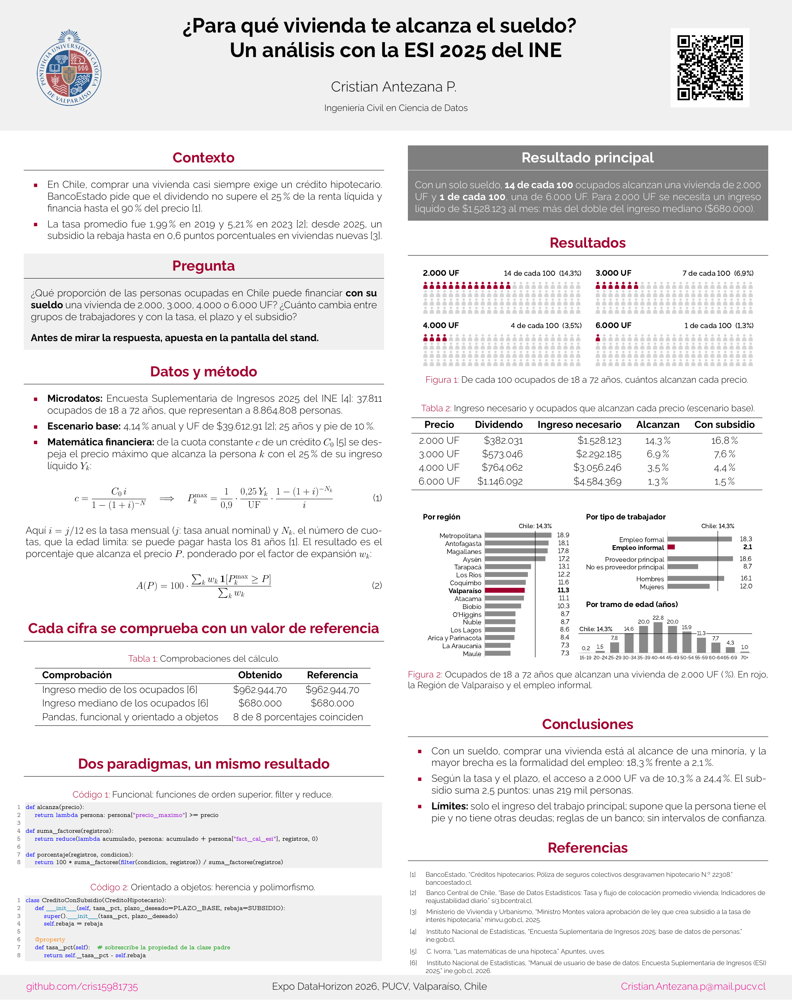

# ¿Para qué vivienda te alcanza el sueldo?

**Asequibilidad hipotecaria de las personas ocupadas en Chile con los microdatos de la ESI 2025**

Proyecto final de Paradigmas de Programación (ICD 2346), Ingeniería Civil en Ciencia de Datos, Pontificia Universidad Católica de Valparaíso, segundo semestre de 2026. También se presenta en la Expo DataHorizon de la carrera (noviembre de 2026).

**Autores:** Cristian Antezana e Ignacio Calderón.

**Presentación:** en Paradigmas de Programación lo presentan y defienden los dos autores; en la Expo DataHorizon lo expone Cristian Antezana.

## La pregunta

¿Qué proporción de las personas ocupadas en Chile podría financiar con su sueldo una vivienda de 2.000, 3.000, 4.000 o 6.000 UF mediante un crédito hipotecario, cómo varía esa proporción entre grupos de trabajadores y cuánto cambia con la tasa, el plazo y el subsidio a la tasa hipotecaria?

## Resultados principales

Escenario base: reglas de BancoEstado (dividendo de hasta 25% de la renta líquida y pie de 10%), tasa de 4,14% anual y plazo de 25 años.

| Precio de la vivienda | Ocupados de 18 a 72 años que la alcanzan | Con subsidio a la tasa |
|---|---|---|
| 2.000 UF | 14,3% | 16,8% |
| 3.000 UF | 6,9% | 7,6% |
| 4.000 UF | 3,5% | 4,4% |
| 6.000 UF | 1,3% | 1,5% |

- Para una vivienda de 2.000 UF se necesita un ingreso líquido de \$1.528.123 al mes; el ingreso mediano de los ocupados es \$680.000.
- La formalidad del empleo es lo que más separa a los grupos: alcanza 2.000 UF el 18,3% de los ocupados formales y el 2,1% de los informales.
- Entre regiones, el acceso a 2.000 UF va de 7,3% (Maule y La Araucanía) a 18,9% (Metropolitana); en Valparaíso es 11,3%.
- Según la tasa y el plazo, el acceso a 2.000 UF va de 10,3% a 24,4%.

## Qué contiene el notebook

`ProyectoFinal_Antezana_Calderon.ipynb` tiene once secciones: introducción y preguntas, marco financiero, descripción de los datos, carga, exploración, limpieza, análisis con Pandas, visualizaciones con Matplotlib, implementación de dos paradigmas, comparación entre paradigmas y conclusiones.

El cálculo central se resuelve tres veces y se comprueba que el resultado sea el mismo:

- con **Pandas** (operaciones vectorizadas y `groupby`);
- con **programación funcional** (funciones puras, `map`, `filter` y `reduce`);
- con **programación orientada a objetos** (clases `Ocupado`, `CreditoHipotecario`, `CreditoConSubsidio` y `Evaluacion`).

El procesamiento reproduce las cifras oficiales del INE: ingreso medio de \$962.944,70 e ingreso mediano de \$680.000.

## Póster

Póster con que se presenta el proyecto en la Expo DataHorizon. Haz clic en la imagen para abrirlo en PDF.

## Presentación

Presentación con que se expone el proyecto en la Expo DataHorizon. Haz clic en la imagen para verla completa en PDF.

## Cómo ejecutarlo

1. Abre el notebook en Google Colab con el botón de arriba.
2. Elige **Entorno de ejecución → Ejecutar todo**.

El notebook descarga la base de la ESI desde el sitio del INE (81 MB; puede tardar uno o dos minutos) y lee los dos archivos del Banco Central desde este repositorio. Usa Pandas, NumPy y Matplotlib, que Colab ya trae instalados.

## Datos y fuentes

| Datos | Fuente | Condiciones de uso |
|---|---|---|
| Encuesta Suplementaria de Ingresos (ESI) 2025, base de personas | Instituto Nacional de Estadísticas (INE). Se descarga desde el [sitio del INE](https://www.ine.gob.cl/estadisticas/sociales/ingresos-y-gastos/encuesta-suplementaria-de-ingresos) | CC BY-SA 4.0, según los términos de uso del INE |
| `TSF_27A.xlsx`: tasa de los créditos para vivienda | Base de Datos Estadísticos del Banco Central de Chile. Descargado el 26-10-2026 | La información pertenece al Banco Central de Chile |
| `UF_IVP_DIARIO.xlsx`: valor diario de la UF en 2025 | Base de Datos Estadísticos del Banco Central de Chile. Descargado el 26-10-2026 | La información pertenece al Banco Central de Chile |

Las referencias completas están en la sección 11.5 del notebook.

## Limitaciones

El análisis usa solo el ingreso del trabajo principal y las reglas de un banco, y supone que todas las personas tienen el pie. No considera otros ingresos, el ingreso de otras personas del hogar ni las deudas. El detalle está en la sección 11.3 del notebook. Es un trabajo académico y no constituye asesoría financiera.

## Uso de inteligencia artificial

Se usó inteligencia artificial como herramienta de apoyo. El detalle está en la sección 11.6 del notebook.
